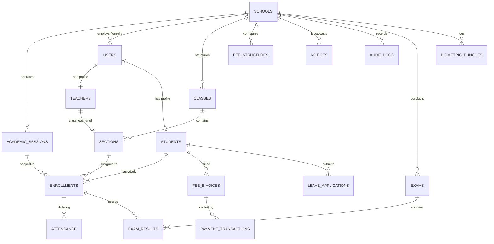

# Skooltech — Database Architecture & Modular Specification

## 1. Database Overview & Core Principles

This document defines the complete PostgreSQL database architecture for **Skooltech**, hosted on **Supabase** and accessed via **Prisma ORM**.

The database is built upon four non-negotiable architectural pillars:
1. **Bulletproof Multi-Tenancy:** Complete tenant isolation at the database layer via PostgreSQL **Row-Level Security (RLS)**.
2. **Strict Financial Immutability:** Accounting transactions and printed fee receipts are write-only/immutable. Never delete or overwrite payment records.
3. **Decoupled Student Lifecycle:** Separation of immutable student identity (`students`) from yearly session enrollments (`enrollments`), enabling effortless academic rollover without duplicate student profiles.
4. **Auditability & Traceability:** High-impact modifications (fee collections, waivers, mark revisions, and attendance alterations) are permanently recorded in an append-only audit trail.

---

## 2. Global Database Rules & Architectural Standards

### Rule 1: Multi-Tenant Tenant Isolation (Row-Level Security)
* Every table storing school-scoped data **must** contain a `school_id UUID NOT NULL` column referencing `schools(id) ON DELETE CASCADE`.
* Denormalize `school_id` even on child tables (e.g., `attendance`, `fee_invoices`, `exam_results`) so PostgreSQL RLS policies can evaluate tenant access without expensive multi-table `JOIN` operations.
* The application sets the tenant session variable on each transaction:
  ```sql
  SET LOCAL app.current_school_id = 'c1b4d8a2-xxxx-xxxx-xxxx-xxxxxxxxxxxx';
  ```

### Rule 2: Currency & Monetary Precision
* All monetary values (fees, discounts, late penalties, collections) **must** use `DECIMAL(10, 2)`.
* **Zero Float Rule:** Never use `FLOAT`, `REAL`, or `DOUBLE PRECISION` for money to prevent IEEE 754 floating-point rounding errors.
* Base Currency: Indian Rupee (**INR / ₹**).

### Rule 3: Date, Time & Regional Standards
* All database timestamps **must** use `TIMESTAMPTZ` (UTC).
* Date-only fields (e.g., attendance date, date of birth) use `DATE`.
* The application layer renders timestamps in Indian Standard Time (`IST` / `Asia/Kolkata`, UTC+05:30).

### Rule 4: Data Preservation (No Hard Deletes on Operational Records)
* Never execute `DELETE FROM` on `students`, `fee_invoices`, `payment_transactions`, or `attendance`.
* Use explicit lifecycle statuses (`ACTIVE`, `ALUMNI`, `WITHDRAWN`, `CANCELLED`) or boolean soft-delete flags (`is_active`).

### Rule 5: Immutable Financial Ledgers
* The `payment_transactions` table is an append-only ledger. Once created, a row must **never** be updated or deleted.
* If a cash entry was made in error, a compensating reversal transaction must be logged.

---

## 3. Entity-Relationship Diagram (ERD)



---

## 4. Modular Schema Specifications

### Module 1: Tenant Core & Academic Sessions

#### Table: `schools`
Stores the institutional tenant account and global school settings.

| Column | Type | Constraints | Description |
|---|---|---|---|
| `id` | `UUID` | `PK, DEFAULT gen_random_uuid()` | Unique internal tenant identifier. |
| `code` | `VARCHAR(20)` | `NOT NULL, UNIQUE` | Short school code (e.g. `DPS01`, `KVS02`) used in login Option B. |
| `slug` | `VARCHAR(50)` | `NOT NULL, UNIQUE` | Subdomain slug (e.g. `dps-delhi`) for future Option A routing. |
| `name` | `VARCHAR(255)` | `NOT NULL` | Registered school name. |
| `affiliation_no` | `VARCHAR(50)` | `NULLABLE` | CBSE / ICSE / State Board Affiliation Code. Printed on receipts. |
| `address` | `TEXT` | `NULLABLE` | Physical school address for receipt headers. |
| `phone` | `VARCHAR(20)` | `NULLABLE` | School contact number. |
| `email` | `VARCHAR(255)` | `NULLABLE` | Official administrative email address. |
| `logo_url` | `TEXT` | `NULLABLE` | Cloud bucket URL of school logo. |
| `currency` | `VARCHAR(5)` | `NOT NULL, DEFAULT 'INR'` | Base operational currency. |
| `grading_scale` | `VARCHAR(20)` | `NOT NULL, DEFAULT 'PERCENTAGE'` | Display scale: `PERCENTAGE`, `CGPA_10`, `CGPA_5`. |
| `payment_gateway` | `VARCHAR(20)` | `NULLABLE` | BYOG provider: `RAZORPAY`, `CASHFREE`, or `MOCK`. |
| `payment_key_id` | `VARCHAR(255)` | `NULLABLE` | School's merchant API Key ID. |
| `payment_secret` | `TEXT` | `NULLABLE` | Encrypted merchant secret key. |
| `created_at` | `TIMESTAMPTZ` | `NOT NULL, DEFAULT NOW()` | Record creation timestamp. |
| `updated_at` | `TIMESTAMPTZ` | `NOT NULL, DEFAULT NOW()` | Record last updated timestamp. |

#### Table: `academic_sessions`
Defines academic years (typically April 1 to March 31 in India).

| Column | Type | Constraints | Description |
|---|---|---|---|
| `id` | `UUID` | `PK, DEFAULT gen_random_uuid()` | Session identifier. |
| `school_id` | `UUID` | `NOT NULL, FK -> schools(id)` | Tenant reference. |
| `name` | `VARCHAR(50)` | `NOT NULL` | Session label (e.g. `2026-2027`). |
| `start_date` | `DATE` | `NOT NULL` | Session start date (e.g. `2026-04-01`). |
| `end_date` | `DATE` | `NOT NULL` | Session end date (e.g. `2027-03-31`). |
| `is_current` | `BOOLEAN` | `NOT NULL, DEFAULT FALSE` | Flag indicating the currently active operational session. |
| `created_at` | `TIMESTAMPTZ` | `NOT NULL, DEFAULT NOW()` | Record creation timestamp. |

* **Constraints:** `UNIQUE(school_id, name)`. Only one session per school may have `is_current = true`.

---

### Module 2: Authentication & RBAC

#### Enum: `user_role`
`SUPER_ADMIN`, `SCHOOL_ADMIN`, `PRINCIPAL`, `ACCOUNTS`, `TEACHER`, `STUDENT`.

#### Table: `users`
Unified authentication accounts across all roles.

| Column | Type | Constraints | Description |
|---|---|---|---|
| `id` | `UUID` | `PK, DEFAULT gen_random_uuid()` | Unique user identifier. |
| `school_id` | `UUID` | `NOT NULL, FK -> schools(id)` | Tenant reference. |
| `username` | `VARCHAR(100)` | `NOT NULL` | Login username or student Admission ID. |
| `password_hash` | `TEXT` | `NOT NULL` | Argon2id / bcrypt hashed password string. |
| `role` | `user_role` | `NOT NULL` | Access control role. |
| `email` | `VARCHAR(255)` | `NULLABLE` | Contact email address for alerts. |
| `phone` | `VARCHAR(20)` | `NULLABLE` | Contact mobile number for SMS/WhatsApp. |
| `must_change_password` | `BOOLEAN` | `NOT NULL, DEFAULT TRUE` | Forces password change upon first login. |
| `is_active` | `BOOLEAN` | `NOT NULL, DEFAULT TRUE` | Account lock / active toggle. |
| `created_at` | `TIMESTAMPTZ` | `NOT NULL, DEFAULT NOW()` | Record creation timestamp. |
| `updated_at` | `TIMESTAMPTZ` | `NOT NULL, DEFAULT NOW()` | Record last updated timestamp. |

* **Constraints:** `UNIQUE(school_id, username)`.

#### Table: `teachers`
Teacher-specific profile extensions.

| Column | Type | Constraints | Description |
|---|---|---|---|
| `id` | `UUID` | `PK, DEFAULT gen_random_uuid()` | Profile identifier. |
| `user_id` | `UUID` | `NOT NULL, UNIQUE, FK -> users(id)` | Linked user account. |
| `school_id` | `UUID` | `NOT NULL, FK -> schools(id)` | Tenant reference. |
| `full_name` | `VARCHAR(255)` | `NOT NULL` | Full teacher name. |
| `employee_id` | `VARCHAR(50)` | `NULLABLE` | School staff code / biometric user ID. |
| `designation` | `VARCHAR(100)` | `NULLABLE` | e.g. "Senior PGT Mathematics". |
| `created_at` | `TIMESTAMPTZ` | `NOT NULL, DEFAULT NOW()` | Record creation timestamp. |

---

### Module 3: Academic Structure & Classes

#### Table: `classes`
Grade levels (e.g. Nursery, Class 1, Class 10).

| Column | Type | Constraints | Description |
|---|---|---|---|
| `id` | `UUID` | `PK, DEFAULT gen_random_uuid()` | Class identifier. |
| `school_id` | `UUID` | `NOT NULL, FK -> schools(id)` | Tenant reference. |
| `name` | `VARCHAR(50)` | `NOT NULL` | Grade label (e.g. `Class 6`, `Class 10`). |
| `numeric_order` | `INTEGER` | `NOT NULL, DEFAULT 0` | Sort order for grade progression. |

* **Constraints:** `UNIQUE(school_id, name)`.

#### Table: `sections`
Sub-divisions of a class (e.g. Section A, Section B).

| Column | Type | Constraints | Description |
|---|---|---|---|
| `id` | `UUID` | `PK, DEFAULT gen_random_uuid()` | Section identifier. |
| `class_id` | `UUID` | `NOT NULL, FK -> classes(id)` | Parent class reference. |
| `name` | `VARCHAR(20)` | `NOT NULL` | Section label (e.g. `A`, `B`, `Rose`). |
| `class_teacher_id` | `UUID` | `NULLABLE, UNIQUE, FK -> teachers(id)` | Teacher holding the "My Class" dashboard. |

* **Constraints:** `UNIQUE(class_id, name)`. Each section has at most one primary Class Teacher.

---

### Module 4: Student Identity & Yearly Enrollment

#### Enum: `student_status`
`PENDING_ACADEMIC`, `PENDING_FEE`, `ACTIVE`, `ALUMNI`, `WITHDRAWN`.

#### Table: `students`
Immutable student identity records that persist across all academic years.

| Column | Type | Constraints | Description |
|---|---|---|---|
| `id` | `UUID` | `PK, DEFAULT gen_random_uuid()` | Student identifier. |
| `user_id` | `UUID` | `NOT NULL, UNIQUE, FK -> users(id)` | Linked login credentials. |
| `school_id` | `UUID` | `NOT NULL, FK -> schools(id)` | Tenant reference. |
| `admission_no` | `VARCHAR(50)` | `NOT NULL` | Immutable school admission number (e.g. `ADM-1042`). |
| `full_name` | `VARCHAR(255)` | `NOT NULL` | Student full legal name. |
| `dob` | `DATE` | `NULLABLE` | Date of birth. |
| `gender` | `VARCHAR(20)` | `NULLABLE` | Gender (e.g. Male, Female, Other). |
| `parent_name` | `VARCHAR(255)` | `NULLABLE` | Father/Mother/Guardian name. |
| `parent_phone` | `VARCHAR(20)` | `NULLABLE` | Primary contact number for transactional SMS/calls. |
| `parent_email` | `VARCHAR(255)` | `NULLABLE` | Primary email for Brevo fee receipts and alerts. |
| `status` | `student_status` | `NOT NULL, DEFAULT 'PENDING_ACADEMIC'` | 3-stage onboarding status or alumni lifecycle. |
| `created_at` | `TIMESTAMPTZ` | `NOT NULL, DEFAULT NOW()` | Date of initial admission. |

* **Constraints:** `UNIQUE(school_id, admission_no)`.

#### Table: `enrollments`
Maps a student to a specific class, section, roll number, and academic session.

| Column | Type | Constraints | Description |
|---|---|---|---|
| `id` | `UUID` | `PK, DEFAULT gen_random_uuid()` | Enrollment identifier. |
| `school_id` | `UUID` | `NOT NULL, FK -> schools(id)` | Denormalized tenant key for RLS performance. |
| `student_id` | `UUID` | `NOT NULL, FK -> students(id)` | Student identity reference. |
| `session_id` | `UUID` | `NOT NULL, FK -> academic_sessions(id)` | Academic year reference. |
| `section_id` | `UUID` | `NOT NULL, FK -> sections(id)` | Assigned class section. |
| `roll_no` | `VARCHAR(20)` | `NULLABLE` | Class roll number (e.g. `24`). |
| `created_at` | `TIMESTAMPTZ` | `NOT NULL, DEFAULT NOW()` | Enrollment timestamp. |

* **Constraints:** `UNIQUE(student_id, session_id)` (A student is enrolled in exactly one class per academic session).

---

### Module 5: Daily Attendance & Biometric Audit

#### Enum: `attendance_status`
`PRESENT`, `ABSENT`, `LATE`, `EXCUSED`.

#### Table: `attendance`
Daily roll-call records submitted by the Class Teacher.

| Column | Type | Constraints | Description |
|---|---|---|---|
| `id` | `UUID` | `PK, DEFAULT gen_random_uuid()` | Attendance entry identifier. |
| `school_id` | `UUID` | `NOT NULL, FK -> schools(id)` | Denormalized tenant key for RLS. |
| `enrollment_id` | `UUID` | `NOT NULL, FK -> enrollments(id)` | Student yearly enrollment reference. |
| `date` | `DATE` | `NOT NULL` | Calendar date of attendance. |
| `status` | `attendance_status` | `NOT NULL, DEFAULT 'PRESENT'` | Daily status. |
| `remarks` | `VARCHAR(255)` | `NULLABLE` | Reason if excused or marked late. |
| `marked_by_id` | `UUID` | `NOT NULL, FK -> users(id)` | User who recorded the roll-call. |
| `created_at` | `TIMESTAMPTZ` | `NOT NULL, DEFAULT NOW()` | Submission timestamp. |
| `updated_at` | `TIMESTAMPTZ` | `NOT NULL, DEFAULT NOW()` | Last update timestamp (audit logged). |

* **Constraints:** `UNIQUE(enrollment_id, date)`. Exactly one attendance record per student per calendar date.

#### Table: `biometric_punches`
Hardware logs from gate scanners used for secondary verification.

| Column | Type | Constraints | Description |
|---|---|---|---|
| `id` | `UUID` | `PK, DEFAULT gen_random_uuid()` | Punch record identifier. |
| `school_id` | `UUID` | `NOT NULL, FK -> schools(id)` | Tenant reference. |
| `device_user_id` | `VARCHAR(50)` | `NOT NULL` | ID configured on the fingerprint/face device. |
| `matched_user_id` | `UUID` | `NULLABLE, FK -> users(id)` | Linked system user. |
| `punch_time` | `TIMESTAMPTZ` | `NOT NULL` | Timestamp recorded by the hardware scanner. |
| `device_name` | `VARCHAR(100)` | `NULLABLE` | e.g. "Main Gate Face Terminal 1". |
| `created_at` | `TIMESTAMPTZ` | `NOT NULL, DEFAULT NOW()` | Ingestion timestamp. |

---

### Module 6: Financials, Fee Schedules & Counter Payments

#### Enum: `fee_billing_cycle`
`MONTHLY`, `QUARTERLY`.

#### Enum: `payment_method`
`CASH`, `UPI`, `BANK_DRAFT`.

#### Table: `fee_structures`
Master fee templates assigned to students or classes.

| Column | Type | Constraints | Description |
|---|---|---|---|
| `id` | `UUID` | `PK, DEFAULT gen_random_uuid()` | Structure identifier. |
| `school_id` | `UUID` | `NOT NULL, FK -> schools(id)` | Tenant reference. |
| `name` | `VARCHAR(100)` | `NOT NULL` | Template name (e.g. "Primary Standard Fee"). |
| `cycle` | `fee_billing_cycle`| `NOT NULL, DEFAULT 'MONTHLY'` | Billing recurrence. |
| `tuition_amount`| `DECIMAL(10, 2)`| `NOT NULL` | Base tuition component. |
| `development_amount`| `DECIMAL(10, 2)`| `NOT NULL, DEFAULT 0.00` | Building / development component. |
| `lab_amount` | `DECIMAL(10, 2)`| `NOT NULL, DEFAULT 0.00` | Computer/Science lab component. |
| `total_amount` | `DECIMAL(10, 2)`| `NOT NULL` | Total base invoice amount. |
| `late_fee_per_day` | `DECIMAL(10, 2)` | `NOT NULL, DEFAULT 10.00` | Daily late penalty after due date. |
| `late_fee_cap` | `DECIMAL(10, 2)` | `NOT NULL, DEFAULT 500.00` | Maximum late penalty limit. |
| `grace_days` | `INTEGER` | `NOT NULL, DEFAULT 5` | Days past due date before penalty begins. |

#### Table: `fee_invoices`
Issued fee vouchers against individual students.

| Column | Type | Constraints | Description |
|---|---|---|---|
| `id` | `UUID` | `PK, DEFAULT gen_random_uuid()` | Invoice identifier. |
| `school_id` | `UUID` | `NOT NULL, FK -> schools(id)` | Denormalized tenant reference for RLS. |
| `student_id` | `UUID` | `NOT NULL, FK -> students(id)` | Target student reference. |
| `title` | `VARCHAR(150)` | `NOT NULL` | e.g. "Quarter 1 (April-June 2026) Fee". |
| `base_amount` | `DECIMAL(10, 2)` | `NOT NULL` | Base fee due. |
| `due_date` | `DATE` | `NOT NULL` | Payment deadline date. |
| `paid_amount` | `DECIMAL(10, 2)` | `NOT NULL, DEFAULT 0.00` | Cumulative amount paid. |
| `is_paid` | `BOOLEAN` | `NOT NULL, DEFAULT FALSE` | Set to true when balance equals 0. |
| `created_at` | `TIMESTAMPTZ` | `NOT NULL, DEFAULT NOW()` | Invoice generation timestamp. |

#### Table: `payment_transactions`
Write-only, immutable transaction ledger for all payments collected.

| Column | Type | Constraints | Description |
|---|---|---|---|
| `id` | `UUID` | `PK, DEFAULT gen_random_uuid()` | Transaction identifier. |
| `school_id` | `UUID` | `NOT NULL, FK -> schools(id)` | Denormalized tenant key for RLS. |
| `invoice_id` | `UUID` | `NOT NULL, FK -> fee_invoices(id)` | Linked fee invoice. |
| `receipt_no` | `VARCHAR(50)` | `NOT NULL, UNIQUE` | Sequential voucher code (e.g. `RCP-2026-0001`). |
| `amount_paid` | `DECIMAL(10, 2)` | `NOT NULL` | Cash/UPI amount collected. |
| `late_fee_charged`| `DECIMAL(10, 2)`| `NOT NULL, DEFAULT 0.00` | Frozen late fee penalty amount. |
| `payment_method` | `payment_method` | `NOT NULL` | `CASH`, `UPI`, or `BANK_DRAFT`. |
| `reference_no` | `VARCHAR(100)` | `NULLABLE` | 12-digit UPI UTR number or Draft number. |
| `bank_name` | `VARCHAR(100)` | `NULLABLE` | Issuing bank name (for Bank Drafts). |
| `collected_by_id` | `UUID` | `NOT NULL, FK -> users(id)` | Accountant who collected the payment. |
| `notes` | `VARCHAR(255)` | `NULLABLE` | Counter cashier notes. |
| `created_at` | `TIMESTAMPTZ` | `NOT NULL, DEFAULT NOW()` | Immutable transaction timestamp. |

---

### Module 7: Examinations & Grading

#### Table: `exams`
Spontaneous exams created by teachers or school administration.

| Column | Type | Constraints | Description |
|---|---|---|---|
| `id` | `UUID` | `PK, DEFAULT gen_random_uuid()` | Exam identifier. |
| `school_id` | `UUID` | `NOT NULL, FK -> schools(id)` | Tenant reference. |
| `name` | `VARCHAR(150)` | `NOT NULL` | e.g. "Periodic Test 1", "Half-Yearly Examination". |
| `exam_type` | `VARCHAR(50)` | `NOT NULL` | Dropdown: `UNIT_TEST`, `MID_TERM`, `FINAL`, `CLASS_TEST`. |
| `start_date` | `DATE` | `NULLABLE` | Exam start date. |
| `created_by_id` | `UUID` | `NOT NULL, FK -> users(id)` | Teacher/Admin who scheduled the exam. |
| `created_at` | `TIMESTAMPTZ` | `NOT NULL, DEFAULT NOW()` | Exam creation timestamp. |

#### Table: `exam_results`
Individual student scores per subject.

| Column | Type | Constraints | Description |
|---|---|---|---|
| `id` | `UUID` | `PK, DEFAULT gen_random_uuid()` | Result entry identifier. |
| `school_id` | `UUID` | `NOT NULL, FK -> schools(id)` | Denormalized tenant key for RLS. |
| `exam_id` | `UUID` | `NOT NULL, FK -> exams(id)` | Exam reference. |
| `enrollment_id` | `UUID` | `NOT NULL, FK -> enrollments(id)` | Student yearly enrollment reference. |
| `subject` | `VARCHAR(100)` | `NOT NULL` | Subject name (e.g. "Mathematics", "Science"). |
| `total_marks` | `DECIMAL(5, 2)` | `NOT NULL` | Maximum possible marks (e.g. 100.00, 80.00). |
| `obtained_marks`| `DECIMAL(5, 2)` | `NOT NULL` | Score secured by the student. |
| `remarks` | `VARCHAR(100)` | `NULLABLE` | e.g. "Good", "Needs Improvement". |
| `created_at` | `TIMESTAMPTZ` | `NOT NULL, DEFAULT NOW()` | Score entry timestamp. |
| `updated_at` | `TIMESTAMPTZ` | `NOT NULL, DEFAULT NOW()` | Last update timestamp (audit logged). |

* **Constraints:** `UNIQUE(exam_id, enrollment_id, subject)`.

---

### Module 8: Leaves, Notices & School Communications

#### Table: `leave_applications`
Student leave requests submitted by parents.

| Column | Type | Constraints | Description |
|---|---|---|---|
| `id` | `UUID` | `PK, DEFAULT gen_random_uuid()` | Application identifier. |
| `school_id` | `UUID` | `NOT NULL, FK -> schools(id)` | Tenant reference. |
| `student_id` | `UUID` | `NOT NULL, FK -> students(id)` | Applicant student reference. |
| `start_date` | `DATE` | `NOT NULL` | Leave start date. |
| `end_date` | `DATE` | `NOT NULL` | Leave end date. |
| `reason` | `TEXT` | `NOT NULL` | Parent explanation for absence. |
| `document_url` | `TEXT` | `NULLABLE` | Cloud bucket URL of uploaded medical slip. |
| `status` | `VARCHAR(20)` | `NOT NULL, DEFAULT 'PENDING'` | `PENDING`, `APPROVED`, `REJECTED`. |
| `reviewed_by_id`| `UUID` | `NULLABLE, FK -> users(id)` | Class Teacher who approved/rejected. |
| `created_at` | `TIMESTAMPTZ` | `NOT NULL, DEFAULT NOW()` | Submission timestamp. |

#### Table: `notices`
School announcement board.

| Column | Type | Constraints | Description |
|---|---|---|---|
| `id` | `UUID` | `PK, DEFAULT gen_random_uuid()` | Notice identifier. |
| `school_id` | `UUID` | `NOT NULL, FK -> schools(id)` | Tenant reference. |
| `title` | `VARCHAR(255)` | `NOT NULL` | Announcement headline. |
| `content` | `TEXT` | `NOT NULL` | Announcement body text / markdown. |
| `target_role` | `VARCHAR(20)` | `NOT NULL, DEFAULT 'ALL'` | Target audience: `ALL`, `TEACHER`, `STUDENT`. |
| `created_by_id` | `UUID` | `NOT NULL, FK -> users(id)` | Author user reference. |
| `created_at` | `TIMESTAMPTZ` | `NOT NULL, DEFAULT NOW()` | Publication timestamp. |

---

### Module 9: Compliance & Security Audit

#### Table: `audit_logs`
Immutable, append-only security and operational audit trail.

| Column | Type | Constraints | Description |
|---|---|---|---|
| `id` | `UUID` | `PK, DEFAULT gen_random_uuid()` | Log entry identifier. |
| `school_id` | `UUID` | `NOT NULL, FK -> schools(id)` | Tenant reference. |
| `user_id` | `UUID` | `NOT NULL, FK -> users(id)` | User performing the action. |
| `user_role` | `VARCHAR(50)` | `NOT NULL` | Role snapshot at the time of action. |
| `action` | `VARCHAR(100)` | `NOT NULL` | Event code (e.g. `FEE_COLLECTED`, `MARKS_UPDATED`). |
| `entity_type` | `VARCHAR(50)` | `NOT NULL` | Table/model affected (e.g. `payment_transactions`). |
| `entity_id` | `UUID` | `NOT NULL` | Primary key of modified row. |
| `old_values` | `JSONB` | `NULLABLE` | JSON snapshot of row state before edit. |
| `new_values` | `JSONB` | `NULLABLE` | JSON snapshot of row state after edit. |
| `ip_address` | `VARCHAR(45)` | `NULLABLE` | Client IP address. |
| `created_at` | `TIMESTAMPTZ` | `NOT NULL, DEFAULT NOW()` | Immutable log timestamp. |

---

## 5. Performance Indexing Strategy

To guarantee sub-50ms query response times even with millions of rows, the following compound indexes are required:

```sql
-- 1. Tenant + Identity Lookups
CREATE INDEX idx_users_school_username ON users(school_id, username);
CREATE INDEX idx_students_school_admission ON students(school_id, admission_no);

-- 2. Daily Attendance Fast Lookups
CREATE INDEX idx_attendance_enrollment_date ON attendance(enrollment_id, date);
CREATE INDEX idx_attendance_school_date ON attendance(school_id, date);

-- 3. Fee Ledgers & Receipt Lookups
CREATE INDEX idx_invoices_student ON fee_invoices(student_id, is_paid);
CREATE INDEX idx_transactions_school_created ON payment_transactions(school_id, created_at DESC);
CREATE INDEX idx_transactions_receipt_no ON payment_transactions(receipt_no);

-- 4. Exams & Results Lookups
CREATE INDEX idx_exam_results_exam_enrollment ON exam_results(exam_id, enrollment_id);

-- 5. Audit Log Filtering
CREATE INDEX idx_audit_school_created ON audit_logs(school_id, created_at DESC);
CREATE INDEX idx_audit_entity ON audit_logs(entity_type, entity_id);
```

---

## 6. PostgreSQL Row-Level Security (RLS) Template

Every table in the database uses this standard policy structure:

```sql
-- 1. Enable RLS on the table
ALTER TABLE students ENABLE ROW LEVEL SECURITY;

-- 2. Create tenant isolation policy
CREATE POLICY tenant_isolation_policy ON students
    FOR ALL
    USING (
        school_id = NULLIF(current_setting('app.current_school_id', true), '')::uuid
    )
    WITH CHECK (
        school_id = NULLIF(current_setting('app.current_school_id', true), '')::uuid
    );
```

---

## 7. Database Seeding Specification (`prisma/seed.ts`)

The database seeder provisions the pre-populated **Sandbox School (`DEMO01`)** with the following deterministic data:

* **School Tenant:** "Greenwood International School", Code: `DEMO01`, Slug: `greenwood-demo`.
* **Academic Session:** Current active session `2026-2027` (April 2026 – March 2027).
* **Classes & Sections:** 
  * Class 5 (Sections A & B)
  * Class 6 (Sections A & B)
  * Class 10 (Section A)
* **Staff Accounts:**
  * 1 School Admin (`admin_demo` / `DemoPass@123`)
  * 1 Principal (`principal_demo`)
  * 1 Accountant (`accounts_demo`)
  * 3 Teachers (e.g. `teacher_sharma` assigned as Class Teacher of Class 5-A)
* **Student Body:** 40 mock students with realistic Indian names, complete with:
  * 30 days of past attendance records (mostly Present, sample Absences).
  * 1 Unit Test exam with entered scores across 5 subjects.
  * Fee structures with sample paid receipts and overdue balances with calculated late fees.
