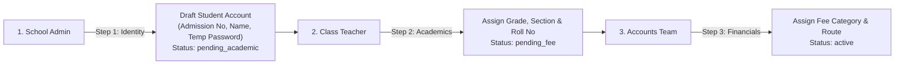

# Skooltech — Master Product Plan (V1 Specification)

## 1. Executive Summary & Vision
**Skooltech** is a scalable, multi-tenant Software-as-a-Service (SaaS) School Management System / Student Information System (SIS) specifically tailored for Indian K-12 schools (CBSE, ICSE, and State Boards).

The primary goal of V1 is to digitize and streamline everyday school operations without overwhelming staff with complicated workflows. It focuses on bulletproof multi-tenant data isolation, zero-friction staged onboarding, fast morning attendance, counter-based fee collection with UPI support, flexible examination grading, and tamper-proof audit trails.

* **Primary Market:** Indian K-12 Private & Public Schools.
* **Base Currency:** Indian Rupee (**INR / ₹**).
* **Academic Calendar:** Typically April to March (flexible per school).

---

## 2. Core Architecture & Multi-Tenancy

### 2.1 Multi-Tenant Isolation
* **Isolation Strategy:** Shared PostgreSQL Database with **Row-Level Security (RLS)**.
* Every school-scoped database table includes a non-nullable foreign key: `school_id`.
* Postgres RLS guarantees at the database level that no query or user from School A can ever read or write School B's records.

### 2.2 Tenant Resolution & Authentication
* **Testing / V1 Phase (Option B):** 
  * Single login portal (`app.skooltech.in/login`).
  * Users authenticate using:
    1. **School Code** (e.g., `DPS01`, `KVS02`)
    2. **Username / Admission ID**
    3. **Password**
* **Production Scale (Option A Transition):**
  * Subdomain routing (e.g., `dpsdelhi.skooltech.in`).
  * The Next.js middleware automatically extracts the subdomain, looks up the `school_id`, and prefills the tenant context without altering user credentials or database schemas.
* **Unified Login & First-Time Reset:**
  * School Admin creates initial accounts with a temporary password and sets `must_change_password = true`.
  * On initial login, the user is immediately forced into a password change screen before accessing their dashboard.

### 2.3 Marketing Website & Sales Strategy (No Empty 14-Day Trials)
* **The Problem with Free Trials:** Setting up an Indian school ERP takes 2–3 weeks (classes, fee structures, student profiles). An empty 14-day self-serve trial presents an empty state that overwhelms school decision-makers.
* **The Solution (3-Pillar Sales Engine):**
  1. **Marketing Website (`/(marketing)`):** Hero landing page, About Us, Pricing (in INR ₹), Contact / Book a Demo form, and School Registration portal.
  2. **1-Click Interactive Demo Sandbox (`DEMO01`):** A pre-populated dummy school tenant with 40+ mock students, real fee records, attendance history, and report cards. Visitors test the live system in 30 seconds without signing up.
  3. **Direct School Registration & Annual Plans:** Schools register directly or request onboarding assistance. Pricing is structured around annual/term contracts with dedicated setup support.

---

## 3. User Roles & Permission Hierarchy

The platform implements Role-Based Access Control (RBAC) across six primary roles:

| Role | Primary Responsibilities & Access |
|---|---|
| **Super Admin** | Platform owner. Creates and manages school tenants, assigns school codes, oversees subscriptions and billing. |
| **School Admin** | Full access to school-level configurations, staff accounts, academic sessions, and initial student profile generation. |
| **Principal** | High-level administrative dashboard: views staff/student attendance metrics, audit trails, publishes final results, and oversees operations. |
| **Accounts** | Cash desk management, fee structure setup (monthly/quarterly), payment collection (Cash, UPI, Draft), dynamic late fee calculation, expense logging, and receipt generation. |
| **Teacher** | Access to assigned classes. **Class Teachers** have an exclusive **"My Class"** tab for daily morning roll-call, leave applications, and class oversight. **Subject Teachers** manage exams and marks entry for their specific subjects. |
| **Student / Parent** | View-only portal: check attendance records, view exam schedules and published report cards, view fee payment receipts and outstanding dues, submit leave applications. |

---

## 4. Student Lifecycle & Onboarding Pipeline

### 4.1 Staged 3-Step Manual Onboarding
To avoid data corruption from messy Excel uploads, V1 utilizes a distributed 3-step onboarding pipeline that spreads manual data entry across staff members:

1. **Step 1 — School Admin (Draft Identity):** Generates immutable `admission_no`, student name, parent phone number, and temporary login credentials (`status = 'pending_academic'`).
2. **Step 2 — Class Teacher (Academic Placement):** Class Teacher finds the draft student in their assigned pool and assigns the Class, Section, and Roll Number (`status = 'pending_fee'`).
3. **Step 3 — Accounts Team (Financial Setup):** Accountant assigns the student their appropriate fee structure (e.g., "Class 6 Standard + Transport Route B"). The student status becomes `active`.
4. **Historical Data Policy:** Schools maintain physical registers for past years; the software initiates fresh records from the current active academic session.

### 4.2 Academic Year Rollover & Promotions
* **Immutable Identity:** The student's `admission_no` never changes throughout their tenure at the school.
* **Separation of Concerns:** Student profiles are separated from yearly enrollments (`students` table vs. `enrollments` table).
* **Bulk Promotion Wizard:**
  * At session close, the Class Teacher or Admin opens the promotion screen for Class 5-A.
  * All students are pre-checked with checkboxes.
  * The teacher unchecks students who failed or transferred out.
  * With 1 click, all checked students are enrolled into Class 6-A for the upcoming session (e.g., `2026-2027`).
  * Unenrolled students past the cutoff date are marked with `status = 'alumni'`.

---

## 5. Daily Attendance Engine

### 5.1 Manual Teacher Roll-Call (Primary)
* **Dedicated "My Class" Tab:** Class Teachers have a dedicated interface on web/mobile for their assigned class section.
* **One-Click Speed:** Includes a **"Mark All Present"** button. The teacher only needs to toggle the 2–3 absent students to `Absent` or `Late`.
* **Frequency:** Conducted once per day during morning assembly / home-period.

### 5.2 Biometric Cross-Checking (Secondary)
* The daily operational flow never depends on biometric hardware uptime or internet availability.
* Biometric logs (from gate fingerprint/face devices) are synced independently to an attendance audit table.
* **Principal Discrepancy View:** Flags mismatches between teacher roll-calls and biometric clock-ins:
  * ⚠️ *Student marked Present by Class Teacher, but NO biometric entry at the school gate.*
  * ⚠️ *Teacher clocked in 30 minutes after scheduled school start time.*

---

## 6. Accounts, Fees & Cash Collection Desk

### 6.1 Fee Structures & Cycles
* **Cycle Toggle:** Accounts team can configure fee schedules as either **Monthly** or **Quarterly** (April, July, October, January).
* **Fee Components:** Tuition Fee, Development Fee, Computer/Lab Fee, Transport Fee, Examination Fee.

### 6.2 Counter Cash Desk Workflow
Accountants work from a dedicated **Cash Collection** interface:
1. Search student by `Admission Number` or name.
2. System instantly displays the student photo, class, section, base fee, and dynamic late fees.
3. Accountant selects the Payment Mode:
   * **Cash**
   * **UPI** (prompts for the 12-digit UPI Reference / UTR Number)
   * **Bank Draft / Cheque** (prompts for Draft/Cheque Number and Bank Name)
4. Accountant enters the amount received (supports full payment or partial payment).
5. Click **"Collect & Save"**:
   * Fee record is updated.
   * Immutable entry is written to `audit_logs`.
   * Printable fee receipt opens automatically (formatted for 80mm thermal receipt printers or standard A4).
   * Transactional receipt is emailed to parent via Brevo.

### 6.3 Dynamic Daily Late Fee Calculation
* Calculated dynamically on read, preventing database overhead:
  $$\text{Days Overdue} = \max(0, \text{Current Date} - (\text{Due Date} + \text{Grace Period}))$$
  $$\text{Late Fee Amount} = \min(\text{Days Overdue} \times \text{Daily Rate}, \text{Maximum Cap})$$
* **Payment Freeze:** Once paid, the calculated late fee is permanently frozen in the transaction receipt record.

### 6.4 Online Fee Collection: BYOG (Bring Your Own Gateway)
* **Zero Liability Model:** Student fee payments must never pass through Skooltech's corporate bank account.
* **School Setup:** School Admins configure their own institutional gateway credentials (e.g., Razorpay Key ID & Secret, or Cashfree App ID & Secret) in School Settings.
* **Direct Settlement:** When a parent pays online via the Student Portal, 100% of the funds settle directly into the school's bank account.
* **Mock Gateway for Development:** All payment UI and receipt generation is developed against a `MockPaymentGateway` adapter, allowing full local testing before live API keys are connected.

---

## 7. Examinations, Grading & Report Cards

### 7.1 Spontaneous Exam Creation
* No rigid, hardcoded semester limits. Teachers and Admins can create exams spontaneously whenever scheduled.
* **Exam Type Dropdown:** Unit Test (PT-1, PT-2), Class Test, Half-Yearly (Term 1), Annual Exam (Term 2), Surprise Test.
* **Mark Distribution:** Teacher defines Maximum Marks per subject (e.g., Mathematics: 80, Science: 80).

### 7.2 Grading Modes (School-Wide Setting)
Raw numbers are always stored as `total_marks` and `obtained_marks`. The school settings determine how grades are rendered on student portals and report cards:

| Grading Option | Formula / Mapping |
|---|---|
| **Percentage** | $(\text{Obtained Marks} / \text{Total Marks}) \times 100$ |
| **CGPA (Scale of 10)** | Standard CBSE scale: $\text{Percentage} / 9.5$ (or custom point matrix) |
| **CGPA (Scale of 5)** | Scaled grade: $\text{Percentage} / 20$ |

* **Student View:** Students can view the complete catalog of upcoming and graded exams, marks breakdown, and download standard printable PDF report cards.

---

## 8. Communication & Leave Management

### 8.1 Transactional Notifications (Brevo Integration)
* **Brevo API (formerly Sendinblue):** Powers all transactional emails.
* **Event Triggers:**
  * Immediate email alert when a student is marked `Absent` during morning roll-call.
  * Instant printable fee receipt sent to parent's email upon payment collection.
  * Scheduled fee default reminders sent when dues pass the cutoff date.
* **Future Pathway:** Brevo's unified API supports seamless future expansion into transactional SMS and the official WhatsApp Business Cloud API.

### 8.2 Student Leave Applications
* Parents/Students submit leave requests from their portal.
* Supports date range, reason category (Medical, Personal, Emergency), and file upload (medical certificates / doctor prescriptions).
* Class Teacher reviews, approves, or rejects requests directly inside their **"My Class"** dashboard.

---

## 9. Security, Governance & Audit Trail

### 9.1 Tamper-Proof Audit Logging (`audit_logs`)
Every sensitive administrative action triggers an immutable record containing:
* `school_id`, `user_id`, `user_role`, `action`
* `entity_type` and `entity_id`
* `old_values` (JSONB) and `new_values` (JSONB)
* `ip_address` and `created_at`

**Logged Events:**
* Cash/UPI fee collections, manual fee waivers, or discounts applied.
* Student mark modifications after initial submission.
* Attendance status overrides.
* Student promotions, transfers, and status changes.

---

## 10. Deliberate Scope Exclusions (Deferred Post-V1)

To protect delivery velocity and avoid technical clutter, the following features are intentionally excluded from V1:
1. **Sibling Account Aggregation:** 1 Student = 1 Dedicated Login. Parents of multiple children log in with each child's respective credentials.
2. **Bulk Excel/CSV Importer:** Replaced by the 3-step staged onboarding pipeline.
3. **Period-by-Period Attendance:** Standardized on once-daily morning roll-call.
4. **Online Payment Gateway Processing:** V1 fee collection is handled at the counter (Cash, UPI with UTR, Bank Draft). Payment gateway integration (Razorpay/Cashfree) will follow in V2.
