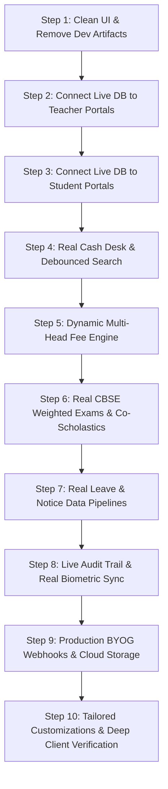

# Skooltech — Master Development Roadmap & Gap Analysis

This document maintains the end-to-end tracking of **Skooltech**:
- **Phase 1 (Initial Scaffold / Prototype):** Completed baseline architecture.
- **Audit of Assumptions & Placeholders:** Comprehensive catalog of all mock data, temporary shortcuts, and simulated components currently in the system.
- **Phase 2 (Production Deepening & Customization Roadmap):** The next 10-step plan to eliminate mocks, connect live relational data, and implement user-directed customizations.
- **Dashboard Specifications:** A dedicated section to map the exact UI components and functionalities for each user role dashboard based on user input.

---

## 🔍 Section 1: Audit of Current Assumptions, Placeholders & Mock Data

### 1.1 Hardcoded Component Rosters & Mock State (Requires Live DB Connection)
- [ ] **Attendance Roll-Call (`AttendanceRollCall.tsx`):**
  - *Current State:* Uses hardcoded client array `DEFAULT_STUDENTS` (25 static students from Roll 1 to 25).
  - *Target State:* Must dynamically fetch live students enrolled in the logged-in teacher's assigned section from `prisma.enrollment`.
- [ ] **Marks Entry Matrix (`MarksEntryModal.tsx`):**
  - *Current State:* Uses static roster `DEFAULT_CLASS_5A_ROSTER` with pre-filled mock scores.
  - *Target State:* Must load live enrolled students and their actual recorded marks for the selected exam and subject.
- [ ] **Student Report Card (`ReportCardModal.tsx` & `/dashboard/student`):**
  - *Current State:* Renders static subject array `DEFAULT_SUBJECT_SCORES` and hardcoded student details (*Aarav Sharma, ADM-1001*).
  - *Target State:* Must query the authenticated student's real `enrollmentId`, active academic session, and joined `exam_results`.
- [ ] **Counter Cash Desk (`CashCollectionModal.tsx`):**
  - *Current State:* Searches through a static in-memory array of 4 demo students with static balances.
  - *Target State:* Must perform debounced Server Action queries against `students` + active `fee_invoices` in PostgreSQL.
- [ ] **Admissions Placement & Fee Queues:**
  - *Current State:* Hardcoded table rows (*Rohan Singhania*, *Pooja Malhotra*) with mock status pills in teacher and accounts dashboards.
  - *Target State:* Must query live `students` records where `status = 'PENDING_ACADEMIC'` or `'PENDING_FEE'`.
- [ ] **Leave Review Queue (`LeaveReviewModal.tsx`):**
  - *Current State:* Uses hardcoded `DEFAULT_PENDING_LEAVES` (*Aarav Sharma*, *Diya Mehta*).
  - *Target State:* Must query live `leave_applications` table where `status = 'PENDING'`.
- [ ] **Audit Trail Viewer (`AuditTrailViewer.tsx`):**
  - *Current State:* Displays static in-memory array `DEFAULT_AUDIT_LOGS`.
  - *Target State:* Must query live append-only records from `prisma.auditLog`.
- [ ] **Notice Board Feed (`NoticeBoardModal.tsx`):**
  - *Current State:* Uses static array `INITIAL_DEMO_NOTICES`.
  - *Target State:* Must query live `notices` table filtered by tenant school and target user role.

### 1.2 Development Artifacts & UI Clutter
- [ ] **Dev Badges Across Screens:**
  - Remove all development labels like `(Step 4B)`, `(Step 5)`, `(Step 6)`, `(Step 7 Feature)`, `(Step 8)` from card titles, buttons, and badges.
- [ ] **Generic SaaS Marketing Pages:**
  - Assess and prune unnecessary public SaaS pages (`/pricing`, `/about`, `/contact`, `/register`) to match the exact intended use case (e.g. internal institutional portal vs. multi-tenant commercial SaaS).

### 1.3 Business Logic & Operational Assumptions
- [ ] **School & Multi-Tenancy Scope:**
  - Current queries in Server Actions rely on `schoolId: session.schoolId` application-level filtering. Needs verification against strict database-level PostgreSQL RLS (`SET LOCAL app.current_school_id`).
  - School name, code (`DEMO01`), and session (`2026-2027`) must not be hardcoded in any component.
- [ ] **Fee Heads & Concession Matrix:**
  - Currently assumes a flat quarterly fee of ₹13,500 with 3 fixed heads (Tuition, Lab, Transport). Real schools require grade-specific fee structures, category concessions (RTE, siblings, staff child), admission fees, and custom fee heads.
- [ ] **Late Fee Calculation:**
  - Currently assumes a flat ₹25/day with a 5-day grace period. Needs support for tiered penalty slabs or fixed post-due date penalty amounts.
- [ ] **Receipt Number Sequencing:**
  - Receipt numbers currently use pseudo-random strings (`RCP-2026-XXXX`). Needs atomic sequential increments per school (`RCP-2026-0001`, `RCP-2026-0002`).
- [ ] **Academic Evaluation & CBSE Standard:**
  - Currently assumes flat subject averages. Real evaluation requires multi-term weight distribution (PT-1 10% + Half-Yearly 30% + PT-2 10% + Final 50%), co-scholastic grading (Art, Physical Education, Work Education, Discipline), and grade point conversion rules.
- [ ] **Biometric Hardware Sync:**
  - Currently a generic REST endpoint (`/api/biometric-sync`). Needs real hardware protocol compatibility (eSSL / ZKTeco ADMS push protocol).

### 1.4 Third-Party Adapter Placeholders
- [ ] **Email & SMS Notifications:**
  - `BrevoNotificationService` and `MockNotificationService` are mock-backed. Indian SMS requires TRAI DLT template registration.
- [ ] **BYOG Payment Gateways:**
  - Razorpay and Cashfree adapters need webhook listener endpoints (`/api/webhooks/razorpay`, `/api/webhooks/cashfree`) for asynchronous payment status handling.
- [ ] **File Storage:**
  - `LocalStorageService` writes to `public/uploads/` on local disk; requires persistent S3 / Supabase Storage adapter for cloud deployment.

---

## 🗺️ Section 2: Phase 2 — 10-Step Deepening & Customization Roadmap

- [ ] **Step 1: UI Cleanup & Removal of Development Artifacts**
  - Strip all `(Step X)` tags, prototype markers, and tutorial badges from all 5 dashboards.
  - Align visual terminology with genuine school administrative nomenclature.
  - Prune or reposition public marketing pages according to the client's deployment model.

- [ ] **Step 2: Dynamic Database Connection for Teacher "My Class" Hub**
  - Replace `DEFAULT_STUDENTS` with a live server query fetching enrolled students for the authenticated teacher's section.
  - Connect the Pending Admissions queue to live `students` records with `status = 'PENDING_ACADEMIC'`.
  - Support multi-section teachers (Subject Teacher vs. Class Teacher views).

- [ ] **Step 3: Dynamic Database Connection for Student & Parent Portal**
  - Replace hardcoded bio (*Aarav Sharma*) with dynamic query for the authenticated session user.
  - Dynamically load fee invoices, actual payment receipts, and real attendance records from PostgreSQL.
  - Support multi-child switching for parents with more than one enrolled student.

- [ ] **Step 4: Live Cash Desk Search & Atomic Receipt Sequencing**
  - Implement debounced live search in `CashCollectionModal.tsx` querying `students` by admission number, phone, or name.
  - Implement atomic PostgreSQL receipt sequence generator (`RCP-2026-0001`, `RCP-2026-0002`).
  - Display actual outstanding fee invoices, past payment history, and support partial payments.

- [ ] **Step 5: Advanced Multi-Head Fee Engine & Concession Matrix**
  - Expand fee structures to support custom heads (Tuition, Annual, Lab, Library, Transport by route/slab).
  - Implement concession categories (RTE quota, Sibling discounts, Staff children, Merit scholarships).
  - Support configurable late fee penalty rules (daily rate vs. tiered slabs vs. flat fee).

- [ ] **Step 6: Multi-Term Weighted Examination Engine & Co-Scholastics**
  - Replace static marks arrays in `MarksEntryModal.tsx` with live rosters for the selected class, exam, and subject.
  - Implement weighted term aggregation: Term 1 (PT-1 10% + Half-Yearly 30%) + Term 2 (PT-2 10% + Final 50%).
  - Add CBSE Part 2 Co-Scholastic Assessment (Work Education, Art Education, Health & Physical Education, Discipline).
  - Dynamically populate `ReportCardModal.tsx` with actual marks, teacher remarks, and school stamps.

- [ ] **Step 7: Live Leave Pipeline & Targeted School Notice Board**
  - Connect `LeaveApplicationModal.tsx` and `LeaveReviewModal.tsx` to live `leave_applications` table.
  - Automatically mark approved leave dates as `EXCUSED` in the `attendance` table.
  - Connect Notice Board to live `notices` table with audience targeting (`ALL`, `TEACHER`, `STUDENT`, or specific grades).

- [ ] **Step 8: Live Audit Trail & Biometric Protocol Integration**
  - Connect `AuditTrailViewer.tsx` to `prisma.auditLog` with real-time pagination, date range, and actor filters.
  - Implement automated SQL reconciliation query between `biometric_punches` and `attendance` for the Principal view.
  - Build standard eSSL / ZKTeco ADMS push protocol compatibility in `/api/biometric-sync`.

- [ ] **Step 9: Production BYOG Webhooks & Persistent Cloud Storage**
  - Build webhook listener endpoints (`/api/webhooks/razorpay`, `/api/webhooks/cashfree`) to handle asynchronous payment drops.
  - Implement persistent cloud storage adapter (AWS S3 or Supabase Storage) with presigned URLs for medical slips, school logos, and photos.
  - Prepare TRAI DLT template structures for Indian transactional SMS delivery.

- [ ] **Step 10: Custom Institutional Rules, Role Polish & Final Verification**
  - Implement client-specified custom changes, rules, and module adjustments.
  - Run comprehensive end-to-end database verification across all roles.
  - Deliver a clean, production-ready release branch.

---

## 📋 Section 3: User-Specified Dashboard Layouts & Functionalities (To Be Defined)

*This section will be populated in detail based on the user's specific instructions for each portal.*

### 3.1 School Admin Dashboard (`/dashboard/admin`)
- *Pending user specifications...*

### 3.2 Principal Dashboard (`/dashboard/principal`)
- *Pending user specifications...*

### 3.3 Accounts & Cash Desk Dashboard (`/dashboard/accounts`)
- *Pending user specifications...*

### 3.4 Teacher Portal ("My Class Hub") (`/dashboard/teacher`)
- *Pending user specifications...*

### 3.5 Student & Parent Portal (`/dashboard/student`)
- *Pending user specifications...*

---

## 📜 Section 4: Phase 1 Baseline Archive (Completed Scaffolding)
- [x] Step 1: Project Scaffolding & Design Foundation (Next.js 16, Tailwind, Poppins, 4px radius, Royal Blue `#1D4ED8`).
- [x] Step 2: Database Architecture, Prisma & Seed Engine (15 Prisma models, seed script for `DEMO01`).
- [x] Step 3: Multi-Tenant Authentication & Session Engine (JWT cookies, unified `/login`, forced password reset).
- [x] Step 4: Staged 3-Step Student Onboarding & Academic Structure (Admin draft, Teacher placement, Accounts fee setup, Rollover wizard).
- [x] Step 5: Daily Attendance Engine & "My Class" Hub (1-click roll-call, biometric sync endpoint stub, principal discrepancy view).
- [x] Step 6: Counter Cash Desk & Financial Management (Dynamic late fees, cash collection modal, printable A4/thermal receipt).
- [x] Step 7: Spontaneous Exams, Grading & Report Cards (Exam creation, marks matrix, CBSE 9-point scale, printable report card).
- [x] Step 8: Leave Management, Notices & Audit Trail (Leave application & review, notice board, immutable audit log).
- [x] Step 9: Third-Party Adapters & Abstraction Placeholders (Brevo email/SMS, BYOG Razorpay/Cashfree, local storage, student portal pay).
- [x] Step 10: Marketing Website, Sandbox Demo Gateway & Vercel Launch Prep (Public pages, 1-click `/demo`, build verified).
